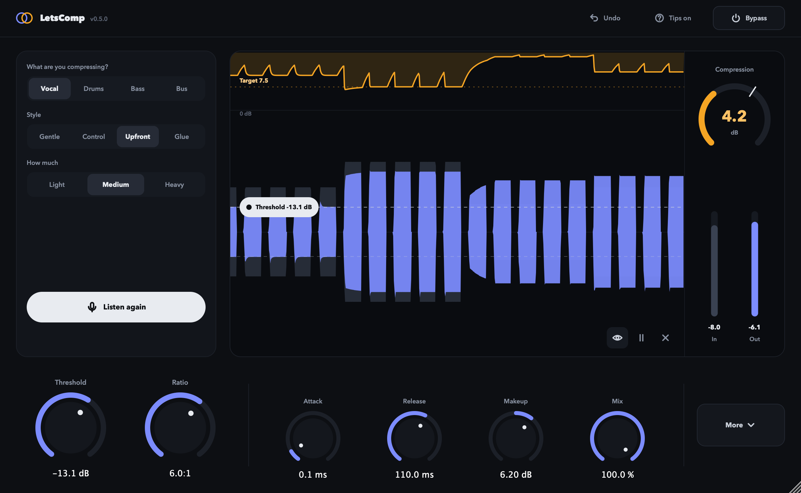

# LetsComp

A free, open-source compressor that listens to your track, sets a starting point, and shows you what the compression is doing.



- **An assistant that listens.** Tell it what you are compressing and how, play ten seconds, and it sets every knob. Hover a knob to read why it chose that value.
- **A scope you can read.** Input, output and gain reduction scroll past live, and you drag the threshold straight in the picture.
- **A full compressor underneath.** Threshold, ratio, attack, release, makeup and mix up front; knee, hold, lookahead, range and a sidechain filter one click away; external sidechain for ducking.
- **Light and clean.** No added latency unless you turn lookahead on, no clicks when you change settings, and well under 1% of one CPU core.

LetsComp runs as an AU, VST3 and CLAP plug-in on macOS 12 or newer (Apple silicon and Intel), and as VST3 and CLAP on Windows when built from source.

## Install

### macOS

1. Download `LetsComp-<version>-macOS.pkg` from [Releases](https://github.com/braenden/LetsComp/releases) and open it.
2. Follow the installer. It installs the Audio Unit, VST3 and CLAP plug-ins; choose Customize to pick only some, and choose whether to install for all users or only for you.
3. Rescan plug-ins in your DAW, or restart it.

The installer and the plug-ins are signed and notarized by Apple, so macOS opens them without warnings.

To install by hand instead, download `LetsComp-<version>-macOS.zip`, unzip it, and copy `LetsComp.component` to `~/Library/Audio/Plug-Ins/Components`, `LetsComp.vst3` to `~/Library/Audio/Plug-Ins/VST3` and `LetsComp.clap` to `~/Library/Audio/Plug-Ins/CLAP`.

### Windows

There is no prebuilt Windows release yet. Build it from source as described under [Build](#build), then copy `LetsComp.vst3` to `C:\Program Files\Common Files\VST3` and `LetsComp.clap` to `C:\Program Files\Common Files\CLAP`.

## Quick start

1. Put LetsComp on the track you want to compress.
2. Pick what it is (Vocal, Drums, Bass or Bus), a style, and how much.
3. Press **Listen** and play the part. It stops by itself after ten seconds.
4. The knobs move to the assistant's starting point. Adjust by ear from there, and hover any knob to read why it was set that way.

**Undo** brings back your settings from before the assistant. **Bypass** compares with the uncompressed sound at the same loudness, because the assistant matches the makeup gain to the input.

### Styles

| Style | What it does |
| --- | --- |
| Gentle | Light levelling that you barely hear |
| Control | Keeps the level steady |
| Punch | Lets the start of each hit through for snap. On a vocal this is **Upfront**: tight and in front, as in modern rap and pop |
| Glue | Makes the parts of a group move together |

**How much** sets Light, Medium or Heavy compression. Changing the source, style or amount afterwards re-runs the assistant on the same take, so you can compare without playing again.

## Controls

| Control | Range | What it does |
| --- | --- | --- |
| Threshold | -60 to 0 dB | Level where compression starts. Drag it on the knob or in the scope |
| Ratio | 1:1 to 20:1 | How firmly levels above the threshold are turned down |
| Attack | 0.05 to 250 ms | How fast compression grabs |
| Release | 1 to 3000 ms | How fast it lets go |
| Makeup | -24 to 24 dB | Turns the compressed signal back up |
| Mix | 0 to 100% | Blends in the dry signal for parallel compression |
| Knee | 0 to 24 dB | How gradually compression starts around the threshold |
| Hold | 0 to 500 ms | Keeps compression in place before releasing |
| Lookahead | 0 to 20 ms | Reacts just before peaks, and adds the same latency |
| Range | Off to 60 dB | The most compression that can ever be applied |
| SC Filter | Off to 500 Hz | Keeps low end out of what the compressor listens to, so a kick or bass does not pump the whole track. The sound itself is not filtered |
| External sidechain | On or off | Compresses by another track's level, for ducking |

Knee, hold, lookahead, range and the sidechain controls sit behind **More**, which names the ones that are on. Tooltips explain every control; turn them off with **Tips** in the header.

### Ducking with the external sidechain

Route the track that should do the ducking (a kick, a voice-over) to LetsComp's sidechain input in your DAW, then open **More** and turn on **External sidechain**. Each DAW routes sidechains its own way: in Logic it is the Side Chain menu at the top of the plug-in window, in Ableton Live the Sidechain section of the device, and in FL Studio a sidechain send from the other mixer track. Without a sidechain input LetsComp listens to the track itself.

The assistant always listens to the track itself and turns the sidechain filter and the external sidechain off when it applies a result.

## How the assistant works

The code is in `Source/assistant`.

- The uncompressed input is measured on 10 ms frames: playing time, loud and quiet levels, crest factor, onset spacing, low-frequency share, and BS.1770 integrated loudness.
- Ratio, knee, attack and the target gain reduction on the loud parts come from a table of sixteen source and style templates in `Recommender.cpp`. The amount scales the target: Light is 0.6 times the style's own amount, Heavy 1.5 times.
- Release follows the part: a share of the median spacing between syllables, hits, notes or beats, clamped per template.
- The threshold is solved by bisection against the real compressor engine, run offline over the take, so the loud frames get the target reduction.
- Makeup matches the output loudness to the input.

`LetsCompAssist` runs the same assistant on audio files:

```bash
build/mac-arm64-release/LetsCompAssist --source vocal --style upfront --amount heavy vocal.wav
```

## Real-time design

- The audio thread performs no allocation, locking, waiting, file I/O or analysis work. The assistant's capture is a preallocated, lock-free buffer, and analysis runs on a background thread.
- The level detector is a 10 ms sliding-window peak, so a steady tone gives a steady target and the static curve holds whatever the attack, release and pitch (down to 41 Hz with under 1% THD).
- Plug-in latency equals the lookahead. At 0 ms lookahead LetsComp adds no delay.
- Threshold, ratio, knee, makeup and mix changes are smoothed over 20 ms. Bypass, the sidechain filter and the sidechain source fade over 20 ms and lookahead crossfades over 10 ms, all along an S-curve with no corners to tick. Range glides at up to 0.5 dB per ms where it meets the gain reduction.
- A host reset (a transport jump or stop) clears the lookahead delay and the envelope, so playback never starts with audio from the previous position. A restart that only picks up a new latency keeps the state, and a lookahead change is reported once the knob has held still for 300 ms.
- Bypass and the dry side of Mix stay aligned to the processed path.

## Build

### macOS

Requirements: macOS 12 or newer, Xcode command-line tools, CMake 3.25 or newer, and Ninja (`brew install cmake ninja`).

```bash
./scripts/build_mac.sh
```

This builds the AU, VST3 and CLAP and runs the tests. `./scripts/install_user.sh` then copies the plug-ins to `~/Library/Audio/Plug-Ins`.

### Windows

Requirements: Visual Studio 2022 with the C++ workload, CMake 3.25 or newer, and Git.

```powershell
./scripts/build_windows.ps1
```

This builds the VST3, CLAP and Standalone and runs the tests.

### Tests

```bash
ctest --test-dir build/mac-arm64-release --output-on-failure
```

The DSP tests cover the gain-computer math, a static curve independent of attack, release and pitch, exact delay and latency, block-boundary independence, click-free transitions for every switch, the sidechain filter and external sidechain, parallel mix, stereo linking, supported sample rates, non-finite input, rapid automation, and realtime performance. The assistant tests cover loudness, onset spacing, the target reduction for every style and amount, makeup, determinism, and quiet or unusable takes. The processor tests cover host bypass, latency reporting, host resets and restarts, the sidechain input, applying and undoing a recommendation, and saving and loading.

## Release

`./scripts/package_mac.sh` builds a universal binary for Apple silicon and Intel, runs the tests, and writes a zip of the AU, VST3 and CLAP and an installer to `build/packages`. The installer lets people pick the formats and install for all users or only themselves; its pages are in `packaging`. Without the settings below everything is signed ad hoc, which is fine for testing on your own Mac, but macOS blocks it on others.

A release that opens without warnings needs a Developer ID Application certificate, plus a Developer ID Installer certificate for the installer. Store the notarization credentials in the keychain once, using an app-specific password from your Apple Account:

```bash
xcrun notarytool store-credentials LetsComp --apple-id "<your Apple Account email>" --team-id "<your team ID>"
```

Then build, sign, notarize and staple:

```bash
PLUGIN_SIGN_IDENTITY="Developer ID Application: <name> (<team ID>)" \
INSTALLER_SIGN_IDENTITY="Developer ID Installer: <name> (<team ID>)" \
NOTARY_PROFILE=LetsComp \
./scripts/package_mac.sh
```

Without `INSTALLER_SIGN_IDENTITY` the zip is still signed, notarized and stapled; only the installer is left unsigned.

## Source layout

- `Source/dsp`: real-time compressor, peak detector, sidechain filter, envelope, gain computer and delay lines
- `Source/assistant`: capture, signal analysis, recommendation templates, and the controller that applies results
- `Source/visualization`: live scope, history, waveforms, threshold, gain-reduction trace and readouts
- `Source/parameters`: host-automatable parameters and their ranges
- `Source/ui`: header, assistant panel, knob row, knobs, buttons, About and the visual theme
- `Tests`: DSP, assistant and processor tests
- `Tools/AssistantCli.cpp`: offline assistant runner

## Licence

Built by Kevin Brenden. Copyright (C) 2026 Kevin Brenden.

LetsComp is free software, released under the GNU Affero General Public License, version 3 (AGPLv3). The full text is in [LICENSE](LICENSE). It comes without any warranty.

LetsComp is built with:

- [JUCE 8](https://juce.com), used under the AGPLv3
- [VST3 SDK](https://github.com/steinbergmedia/vst3sdk), MIT
- [CLAP](https://github.com/free-audio/clap) and [clap-juce-extensions](https://github.com/free-audio/clap-juce-extensions), MIT
- AudioUnitSDK, Apache 2.0, as included with JUCE

The BS.1770 K-weighting filter uses the analogue prototype constants published with [libebur128](https://github.com/jiixyj/libebur128) (MIT).

VST is a registered trademark of Steinberg Media Technologies GmbH. Audio Unit is a trademark of Apple Inc.
